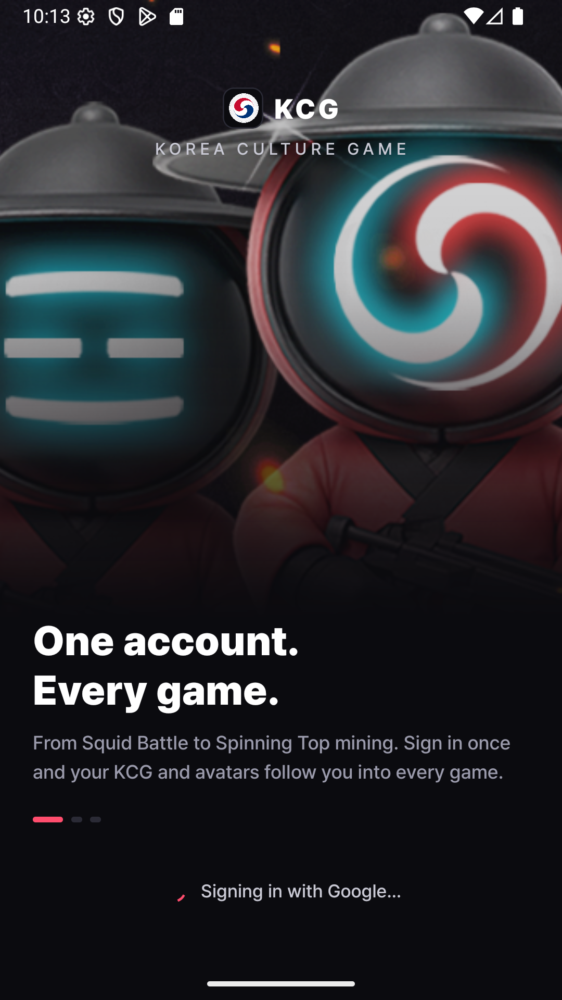
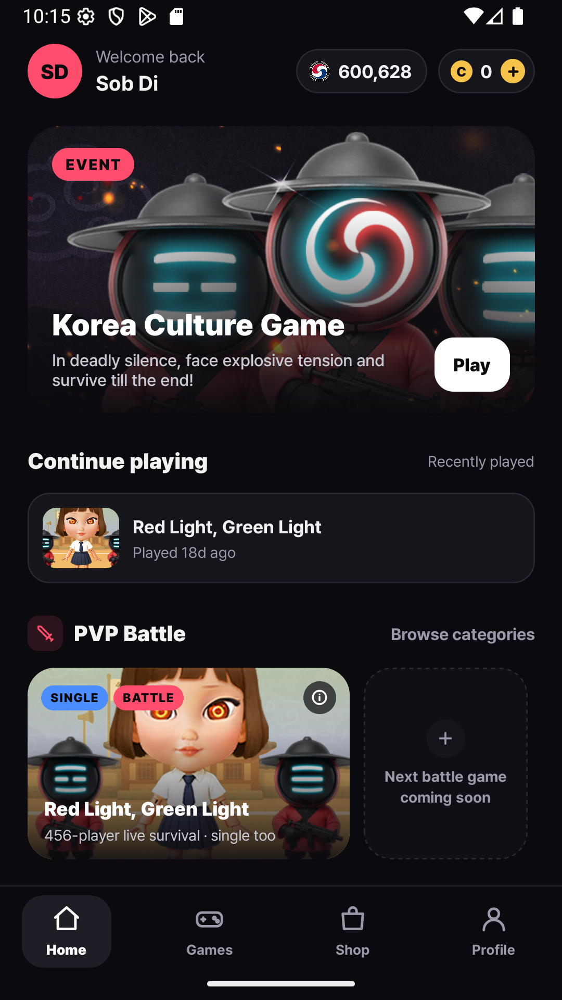
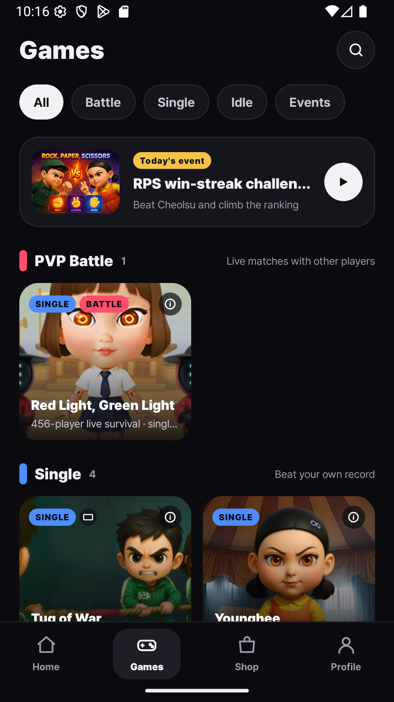
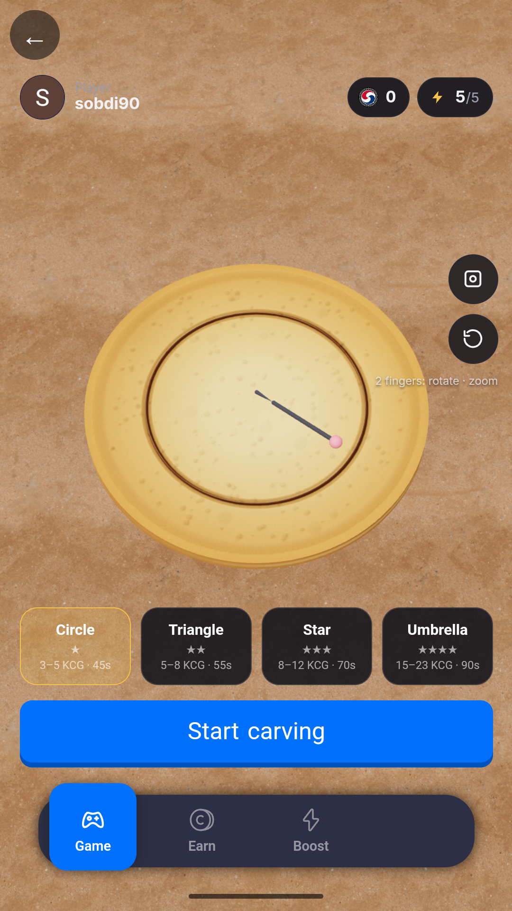
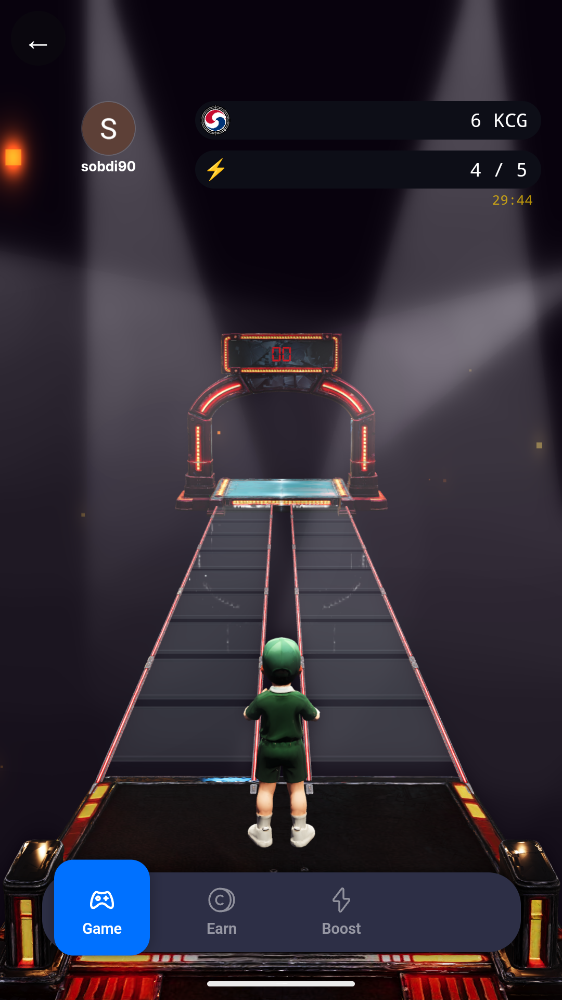
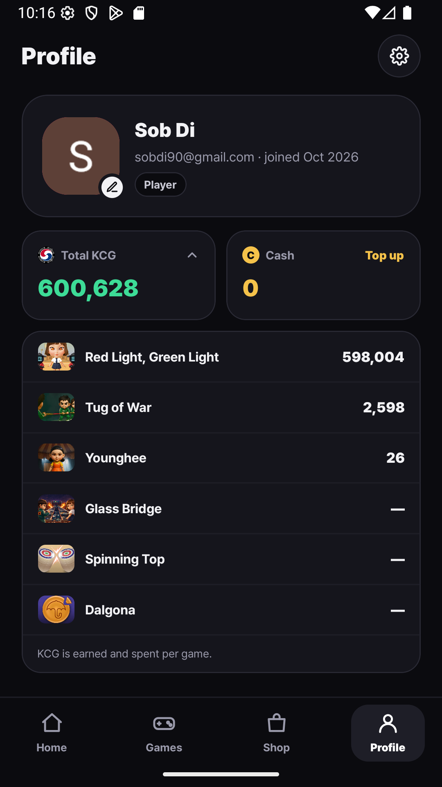

# The games

All games run inside the KCG Android app (each game is a web game served from its own `*.koreaculturegame.com` host). Results are judged on our servers; rewards are credited only after server validation.

| Game | Mode | How it plays | Reward |
|---|---|---|---|
| **Red Light, Green Light** | Single · 456-player live battle | Tap to run while the doll faces away; freeze when she turns. In battle mode hundreds of players share one live round. | Points per step; HP system; battle prizes |
| **Tug of War** | Single (landscape) | Tap rush against the CPU team. | Points per win |
| **Younghee** | Single | Jump and keep your HP up as the pace rises. | Points per touch |
| **Glass Bridge** | Single (3D) | Pick the safe panel, step by step; one wrong panel and you fall. | 1 KCG per safe step |
| **Spinning Top (Paengi)** | Idle | Set the top spinning and collect what it mined when you return (4-hour cycles, grades Wood → Diamond). | KCG per second by grade |
| **Dalgona** | Single (3D) | Trace a stamped outline out of a thin honeycomb candy with a needle. Stay on the line and under the speed cap or it cracks. 14 shapes from ★1 (circle) to ★6 (snowflake, dragon with scales). | 3–122 KCG per clear, ×1.5 speed bonus |
| **Rock Paper Scissors** | Daily event | Beat Cheolsu in a win-streak and climb the daily ranking. | Event prizes |

## Units

Two in-game units exist for historical reasons:

- **Points** — Red Light Green Light, Tug of War, Younghee. 1,000 points = 1 KCG.
- **KCG** — Glass Bridge, Spinning Top, Dalgona credit KCG directly.

Both are game currency held in our game database. See [kcg-in-game-economy.md](kcg-in-game-economy.md) for how game currency relates to the on-chain KCG token.

## Screenshots (Android app, 1080×1920)

| | | |
|---|---|---|
|  |  |  |
|  |  |  |
